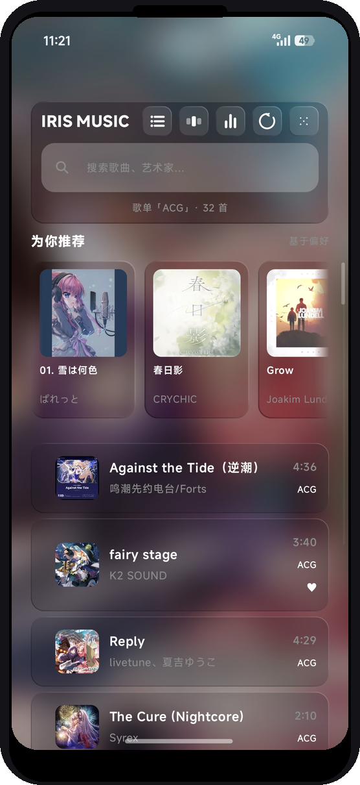
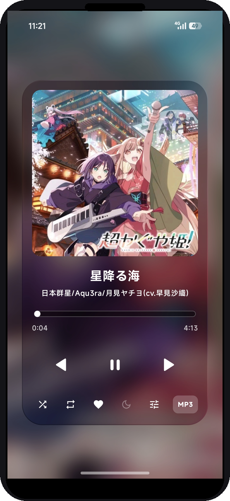
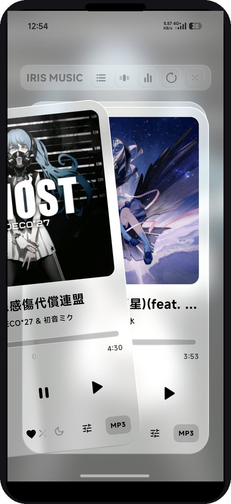
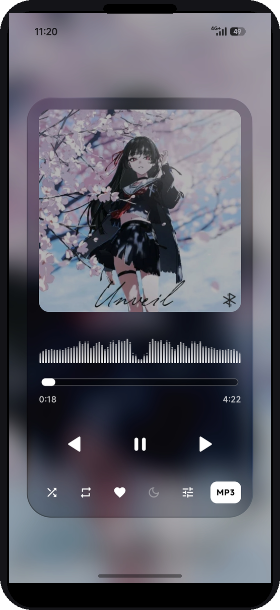
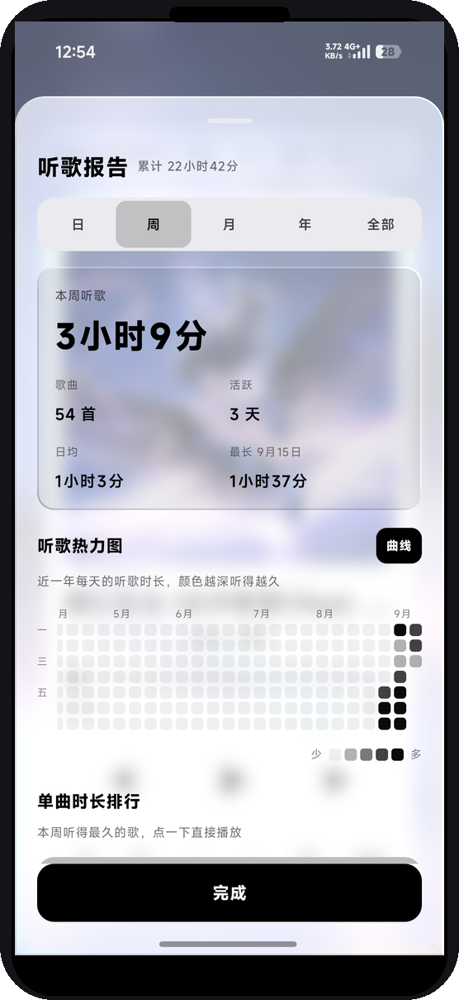
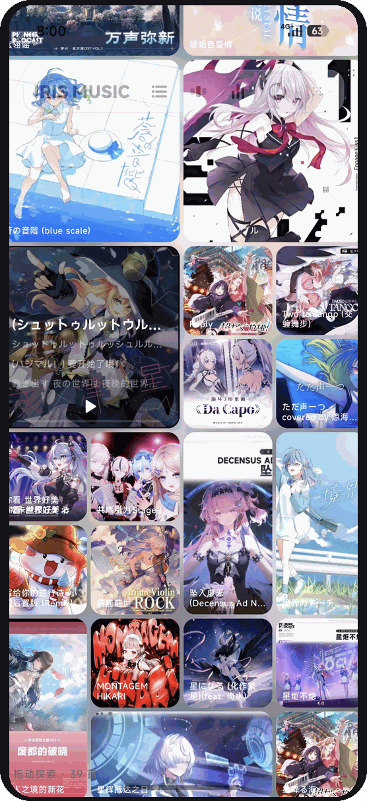

# IRIS Music

**A quiet, local music player**

Your music, laid out as simple cards. No network, no account — your data stays with you.

[Download](https://github.com/WWRJ3321/IRISMusic/releases/latest) · [Features](#features) · [Screenshots](#screenshots) · [中文](README.md) · [Disclaimer](REMIND.md)

 

<table>
<tr>
<td align="center"> Library</td>
<td align="center"> Player card</td>
<td align="center"> Stack</td>
</tr>
</table>

 

## Features

| | |
|:--|:--|
| 👀 **What you see** | Four layouts — list, carousel, stack, poster wall — with layout, colors, light/dark and material all independent; solid, frosted glass and true-refraction liquid glass; Mono / Ocean / Grass, or pick your own primary and secondary; four lyric forms — scrolling, karaoke, floating, on-cover. |
| 🎧 **What you hear** | Free-curve equalizer plus virtual bass, wide surround, range enhancer, safe limiter and loudness normalization; rhythm haptics tapping with the kick drum, harder on stronger beats. |
| 🧠 **What you don't see** | On-device recommendations with an adjustable "exploration" dial; a listening report; offline by default — the only request ever is a manual "check for updates" call to GitHub, no telemetry. |

> The poster-wall interaction is inspired by [Folia](https://github.com/chthollyphile/folia-major), used with the author's permission and implemented independently.

## Screenshots

<table>
<tr>
<td align="center"> Player card</td>
<td align="center"> Listening report</td>
<td align="center"> Poster wall</td>
</tr>
</table>

## Install

Download `IRISMusic-*-arm64-v8a.apk` from [Releases](https://github.com/WWRJ3321/IRISMusic/releases/latest) (nearly every recent phone is arm64) and install it.

Grant "read audio" on first launch. Floating lyrics also need "display over other apps" in system settings.

## About

IRIS Music is a personal project — no team, no KPIs, not commercial. It's simply the player I want to use.

Please read [REMIND.md](REMIND.md) first. The software is provided as is, without warranty, and contains no music; you are responsible for the audio you import.

## License

Copyright © 2026 WWRJ

The original source code is licensed under [GPL-3.0](LICENSE): use, modify and distribute freely; if you distribute a modified version, the whole derivative work must also be open-sourced under GPL-3.0. See [REMIND.md](REMIND.md) and [NOTICE](NOTICE).

 

Made by WWRJ

