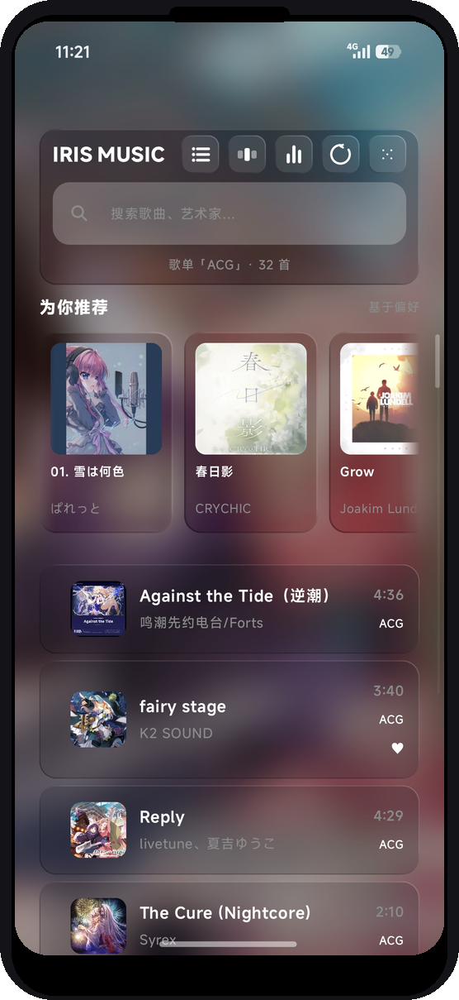
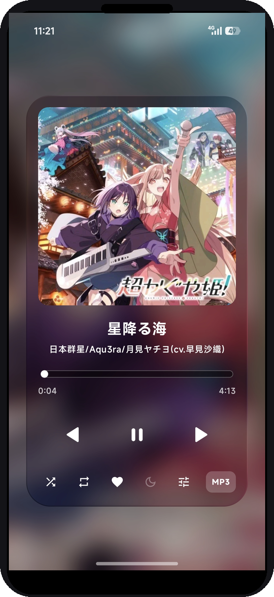
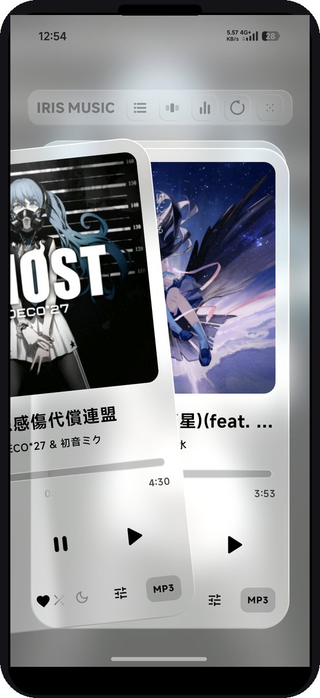
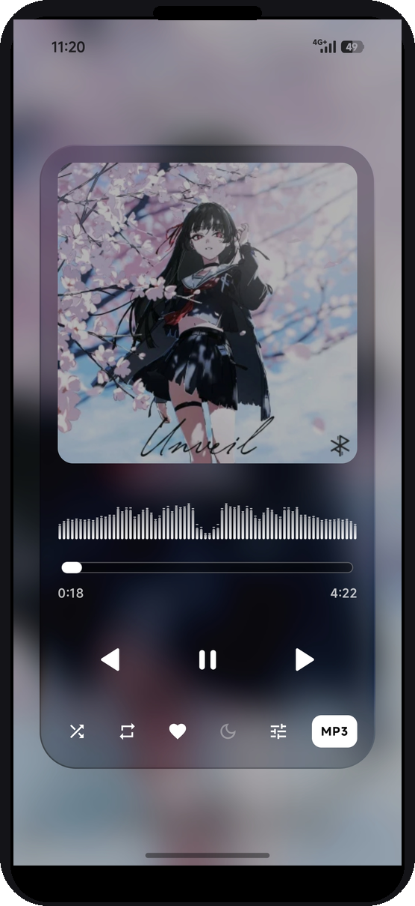
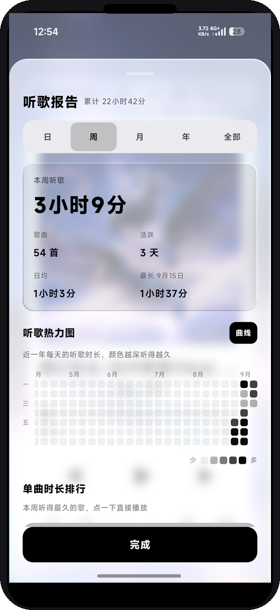

# IRIS Music

**一个安静的本地音乐播放器**

把手机里的歌，用简单的卡片铺开。不联网，不要账号，数据只留在你手里。

[下载](https://github.com/WWRJ3321/IRISMusic/releases/latest) · [功能](#功能) · [截图](#截图) · [English](README.en.md) · [免责声明](REMIND.md)

 

<table>
<tr>
<td align="center"> 歌单</td>
<td align="center"> 播放卡片</td>
<td align="center"> 堆叠</td>
</tr>
</table>

 

## 功能

| | |
|:--|:--|
| 🖼 **看得见的** | 四种排布：纵向列表、横向卡片、堆叠、唱片墙，排布、配色、明暗、材质互不绑定；实色 / 毛玻璃 / 真折射液态玻璃三种材质；黑白 / 深海蓝 / 青草绿，或用取色方块调出自己的主色与次色；全屏滚动、逐字扫光、悬浮、封面四种歌词。 |
| 🎧 **听得见的** | 自由曲线均衡器，加虚拟低音、宽场环绕、动态范围增强、防失真保护、响度均衡；音律震动跟着底鼓轻轻震，力度随鼓点强弱变化。 |
| 🧠 **看不见的** | 本地推荐按点赞、播放、跳过给整个曲库打分，可调「探索度」；听歌报告统计最常听的歌；默认不联网，只有手动打开「检查更新」时才向 GitHub 发一次请求，不含任何统计。 |

> 唱片墙的交互灵感来自 [Folia](https://github.com/chthollyphile/folia-major)，已获原作者授权，代码为独立实现。

## 截图

<table>
<tr>
<td align="center"> 播放卡片</td>
<td align="center"> 听歌报告</td>
<td align="center"> 唱片墙</td>
</tr>
</table>

## 安装

在 [Releases](https://github.com/WWRJ3321/IRISMusic/releases/latest) 下载 `IRISMusic-*-arm64-v8a.apk`（近几年的手机基本都是 arm64），直接安装。

首次打开授予「读取音频」权限即可。悬浮歌词需要在系统设置里允许「显示在其他应用上层」。

## 关于

IRIS Music 是一个个人项目：没有团队，没有 KPI，也不商业化，只做我自己想用的样子。

使用前请先阅读 [REMIND.md](REMIND.md)。本软件按「原样」提供，不附带任何担保；不包含任何音乐内容，导入的音频由使用者自行负责。

## 许可

Copyright © 2026 WWRJ

自有源码以 [GPL-3.0](LICENSE) 授权：可以自由使用、修改和分发；对外分发修改版时，整个衍生作品也必须以 GPL-3.0 开源。详见 [REMIND.md](REMIND.md) 与 [NOTICE](NOTICE)。

 

Made by WWRJ

